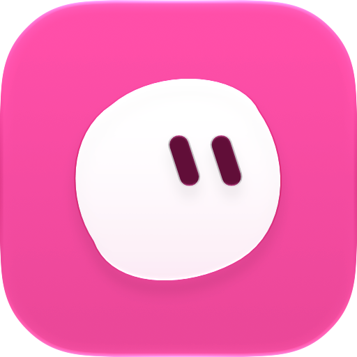
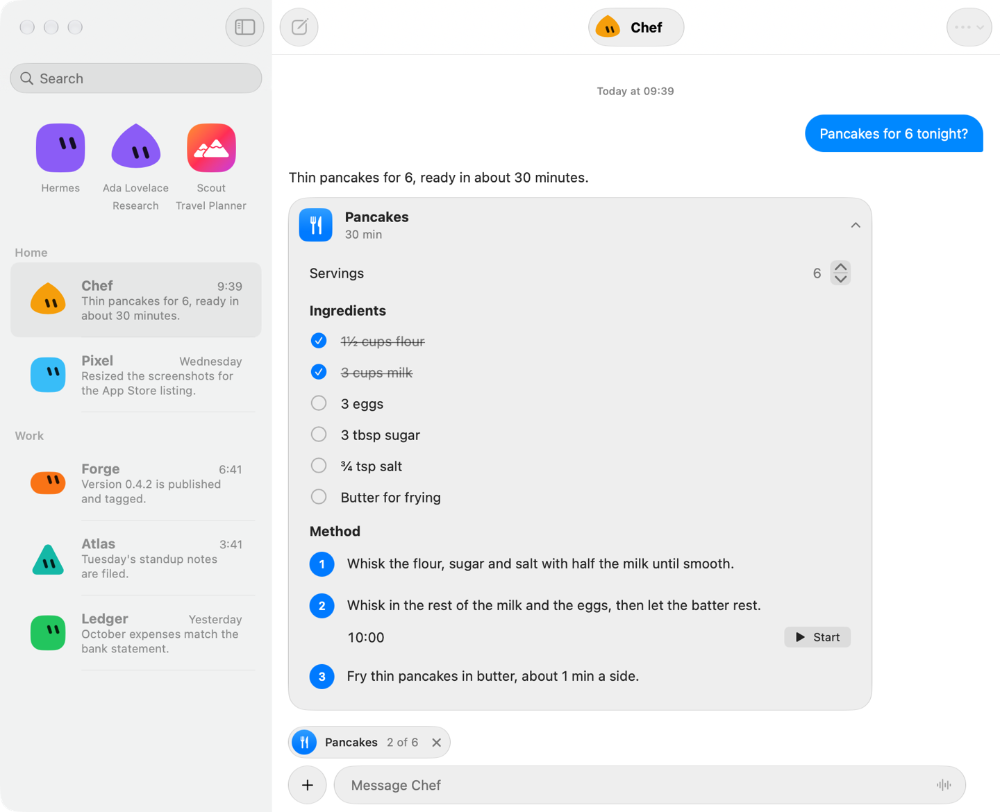

<div align="center">



# Crew

**Your Hermes bots, native on iPhone, iPad and Mac.**

Chat with every bot on your server, hear back on the lock screen, and get replies as cards you can tick, scale and tap.

[Download](https://github.com/gustaferiksson/crew/releases/latest) · [Install with Homebrew](#install) · Requires macOS 27 or iOS 27

</div>

<p align="center">
  
</p>

## What it does

Crew is a native SwiftUI client for [Hermes Agent](https://github.com/NousResearch/hermes-agent). Each profile on your server shows up as a bot with its own face, chat and routines, like contacts in Messages. It talks to `hermes dashboard` over its REST API and WebSocket gateway, so there is nothing extra to run on the server for the basics.

| | |
|---|---|
| **Chat** | Every bot's Bot Chat, with tool calls and reasoning live as they run, attachments, dictation, `@`-mentions of other bots and slash commands. |
| **Cards** | Bots can answer with interactive cards: checklists, tables, maps, forms and recipes whose servings rescale and whose steps have timers. The newest card pins above the composer. |
| **Approvals and questions** | A bot that wants to run a risky command or needs an answer asks in the chat, and its notification takes you straight there. |
| **Notifications** | Finished turns, approvals, questions and routines, also while Crew is closed, through the bundled `crew-push` plugin. |
| **Bots** | Edit a bot's look, instructions, model, skills and connections (MCP servers, with each one's tools and context cost). |
| **Routines** | Schedule, run, pause and stop a bot's routines. |
| **Group rooms** | Put 2 to 6 bots in one room and let them work it out together. |
| **Payments** | With `crew-push`, a bot can fill a stored card into a shop's checkout, only after you hold to approve the amount and merchant in Crew. |
| **Updates** | The Mac app updates itself; the iPhone app shows a banner when a newer build is out. |

Crew signs in with your dashboard account and keeps only the session cookies in the Keychain, never your password.

## Install

**macOS** (macOS 27 or newer):

```sh
brew install --cask gustaferiksson/tap/crew
```

Or download `Crew-<version>.zip` from the [latest release](https://github.com/gustaferiksson/crew/releases/latest) and move `Crew.app` to `/Applications`.

**iOS** (iOS 27 or newer): builds are Ad Hoc signed, so they install only on devices registered to the developer account. On a registered device, open [gustaferiksson.github.io/crew](https://gustaferiksson.github.io/crew/) in Safari and tap Install.

## Set up

1. Run Hermes Agent 0.21.3 or newer with `hermes dashboard` behind HTTPS.
2. Turn on dashboard authentication with the `basic` (username and password) provider.
3. Open Crew and sign in with the dashboard's address and account.

For notifications while Crew is closed, and for payments, install `crew-push` on the Hermes host (Hermes v0.23.0 or later): see [`server/crew-push/README.md`](server/crew-push/README.md). Each release attaches `crew-push-<version>.tar.gz`; the plugin is versioned separately from the app.

<details>
<summary><b>How it works</b></summary>

<br>

Crew is one SwiftUI codebase for iOS, iPadOS and macOS. Chats, approvals and questions run over the dashboard's WebSocket gateway; bots, routines, skills and connections over its REST API. Cards are [A2UI](https://github.com/a2ui-project/a2ui) surfaces the bot writes into its reply, taught by the `crew-ui` skill Crew installs on each bot, and drawn with native controls.

`crew-push` is a Hermes plugin. It hooks the end of each turn, approvals and questions and sends them to Apple's push service, and it guards payments: every card fill needs an amount, a merchant and a reason, and waits for your approval in Crew. Design notes and decisions live in [`docs/PLAN.md`](docs/PLAN.md).

</details>

<details>
<summary><b>Building from source</b></summary>

<br>

You need Xcode 27 and [XcodeGen](https://github.com/yonaskolb/XcodeGen) (`brew install xcodegen`).

```sh
cp .env.example .env   # set DEVELOPMENT_TEAM for a team-signed build
./build.sh             # macOS app and iOS Simulator build, fails on any warning
./device.sh            # build, install and launch on a connected iPhone (needs DEVELOPMENT_TEAM)
```

Without `.env` the Mac build is ad hoc signed. `CREW_PUSH=1` in `.env` signs with the push entitlements (see the plugin README). The Xcode project is generated by XcodeGen and isn't tracked. Releases are built by `package.sh` in CI, see [`docs/release.md`](docs/release.md).

</details>

## License

[MIT](LICENSE). Parts of `server/crew-push` are adapted from hermex-push; see its [`NOTICE`](server/crew-push/NOTICE).
